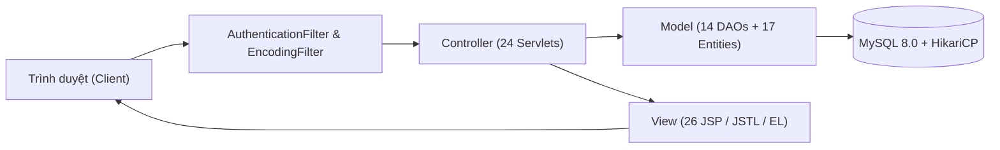
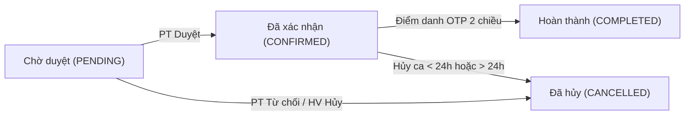

# DÀN BÀI & NỘI DUNG TỪNG SLIDE THUYẾT TRÌNH — ĐỒ ÁN PT-CONNECT

> **Môn học:** Công nghệ phần mềm  
> **Đề tài:** PT-Connect — Nền tảng Quản lý & Kết nối Huấn luyện viên cá nhân (Personal Trainer)  
> **Cấu trúc:** 12 Slide (Thời lượng thuyết trình & demo dự kiến: 8–10 phút)

---

## Slide 1: Trang Bìa (Title Slide)

### Nội dung trên Slide
* **Tên đề tài:** **PT-CONNECT** — Hệ Thống Web Quản Lý & Kết Nối Huấn Luyện Viên Cá Nhân (PT)
* **Kiến trúc:** Java Web Enterprise (JSP Model 2 / MVC)
* **Môn học:** Công nghệ phần mềm
* **Thành viên thực hiện:** *(Điền tên nhóm / MSSV của bạn)*
* **Giảng viên hướng dẫn:** *(Điền tên giảng viên)*

### 🎙️ Lời nói gợi ý (Speaker Notes)
> "Em xin kính chào thầy/cô trong Hội đồng. Hôm nay em xin đại diện nhóm trình bày đồ án môn Công nghệ phần mềm với đề tài: **PT-Connect — Nền tảng quản lý và kết nối huấn luyện viên cá nhân**, được xây dựng theo chuẩn kiến trúc MVC Model 2 trên nền tảng Java Servlet và JSP."

---

## Slide 2: Đặt Vấn Đề (Problem Statement)

### Nội dung trên Slide
| Đối tượng | Nỗi đau thực tế (Pain Points) |
| :--- | :--- |
| 🎓 **Học viên (Student)** | • Khó kiểm chứng bằng cấp, uy tín của PT tự do. • Dễ bị hủy lịch đột ngột, không có hợp đồng ràng buộc. • Dễ xảy ra tranh chấp khi tự đếm số buổi tập còn lại. |
| 🏋️ **Huấn luyện viên (PT)** | • Chốt lịch thủ công qua chat/Excel dễ bị trùng giờ (conflict). • Bị học viên hủy sát giờ mà không có cơ chế phạt/bồi thường. • Khó quản lý giáo án và theo dõi tiến độ từng học viên. |

### 🎙️ Lời nói gợi ý
> "Xuất phát từ thực tế việc thuê PT cá nhân hiện nay chủ yếu qua thỏa thuận miệng hoặc tin nhắn: Học viên thì lo ngại chất lượng PT và sợ mất tiền oan; ngược lại PT cũng gặp khó khăn khi quản lý lịch rảnh dễ bị trùng giờ, hoặc bị học viên hủy sát giờ gây thiệt hại thu nhập. Vì vậy nhóm em xây dựng PT-Connect để chuẩn hóa toàn bộ quy trình này."

---

## Slide 3: Giải Pháp PT-Connect & Phạm Vi Hệ Thống

### Nội dung trên Slide
* **Chu trình khép kín trên PT-Connect:**
  1. 🛡️ **Xác thực năng lực:** Admin phê duyệt hồ sơ & chứng chỉ của PT trước khi mở bán.
  2. 📄 **Hợp đồng điện tử PDF:** Thanh toán qua Ví nội bộ, tự động sinh hợp đồng pháp lý PDF.
  3. 📅 **Quản lý khung giờ thông minh:** PT mở slot rảnh, hệ thống chặn trùng/chồng lấn giờ.
  4. 🔐 **Điểm danh 2 chiều (OTP):** PT mở mã OTP 6 số, học viên nhập xác nhận mới trừ buổi tập.
  5. 📋 **Giáo án cá nhân hóa:** PT giao bài tập (sets, reps, mức tạ, video demo) theo từng hợp đồng.

### 🎙️ Lời nói gợi ý
> "Hệ thống giải quyết triệt để vấn đề cho cả 3 vai trò Admin, PT và Học viên với 15 Use Case cốt lõi, số hóa từ khâu kiểm duyệt bằng cấp, ký hợp đồng PDF tự động, đặt lịch theo slot, đến điểm danh OTP 2 chiều và giao giáo án."

---

## Slide 4: Kiến Trúc Hệ Thống (MVC Model 2)

### Nội dung trên Slide

* **View (`/WEB-INF/views/`):** 26 trang JSP thuần hiển thị, đặt trong `WEB-INF` ngăn truy cập trực tiếp.
* **Controller (`controller/`):** 24 Servlet xử lý `doGet`/`doPost`, phân quyền theo URL qua `AuthenticationFilter`.
* **Model (`model/`):** Tách biệt hoàn toàn **Entity (POJO)** và **DAO** (đóng gói toàn bộ câu lệnh SQL).

### 🎙️ Lời nói gợi ý
> "Về kiến trúc, hệ thống tuân thủ nghiêm ngặt mô hình MVC Model 2. Mọi request đều phải đi qua Filter để kiểm tra phiên đăng nhập và phân quyền vai trò trước khi vào Servlet Controller. Tầng JSP chỉ dùng JSTL và EL để hiển thị, tuyệt đối không chứa mã Java hay SQL. Toàn bộ truy vấn dữ liệu được đóng gói gọn trong tầng DAO."

---

## Slide 5: Công Nghệ Cốt Lõi (Tech Stack)

### Nội dung trên Slide
| Thành phần | Công nghệ sử dụng | Vai trò trong dự án |
| :--- | :--- | :--- |
| **Ngôn ngữ & Web API** | Java 17, Jakarta EE 10 (Servlet 6.0), JSTL 3.0 | Xử lý luồng nghiệp vụ & giao diện động |
| **Cơ sở dữ liệu** | MySQL 8.0 + HikariCP (Connection Pool) | Lưu trữ 14 bảng quan hệ & tối ưu kết nối |
| **Bảo mật** | jBCrypt (0.4), `AuthenticationFilter` | Băm mật khẩu an toàn & phân quyền RBAC |
| **Xuất tài liệu** | OpenPDF (2.0.3) + Font Tiếng Việt | Sinh hợp đồng điện tử PDF tự động |
| **Build & Triển khai** | Maven, Embedded Jetty 12, Docker Compose | Đóng gói đồng nhất, chạy 1 câu lệnh |
| **Kiểm thử** | JUnit 5 (Jupiter 5.10.2) | Kiểm thử tự động tầng DAO |

### 🎙️ Lời nói gợi ý
> "Hệ thống sử dụng Java 17 và Jakarta EE 10, kết hợp HikariCP để quản lý Connection Pool hiệu năng cao. Mật khẩu người dùng được băm bằng BCrypt. Ngoài ra nhóm tích hợp thư viện OpenPDF để xuất hợp đồng tiếng Việt và đóng gói toàn bộ Web + MySQL bằng Docker Compose để triển khai nhanh chóng."

---

## Slide 6: Truy Vết Thiết Kế 1–1 (Traceability)

### Nội dung trên Slide
* **Đảm bảo tính nhất quán từ Tài liệu Thiết kế ➔ Mã nguồn:**
  * **17 Entity Classes** (`User`, `Student`, `PT`, `Admin`, `PTProfile`, `Course`, `Enrollment`, `AvailabilitySlot`, `Booking`, `Attendance`, `Cancellation`, `Wallet`, `Payment`, `WorkoutPlan`, `Workout`, `Review`, `PTLocation`) ➔ Ánh xạ 1–1 từ Entity Class Diagram.
  * **14 DAO nghiệp vụ** (+ `DAO` base & `DBContext`) ➔ Tương ứng 14 bảng CSDL trong `init.sql`.
  * **24 Servlet Controllers** ➔ Bao phủ đầy đủ **15 Use Case chính** cùng các trang điều hướng.
* **Áp dụng OOP & Design Patterns:**
  * Kế thừa phân cấp: `User` ➔ `Student`, `PT`, `Admin`.
  * **DAO Pattern:** Controller hoàn toàn "sạch" mã SQL, dễ bảo trì và mở rộng.

### 🎙️ Lời nói gợi ý
> "Điểm mạnh về mặt Công nghệ phần mềm của đồ án là tính truy vết 1–1 giữa thiết kế và cài đặt. Toàn bộ 17 lớp Entity, 14 DAO nghiệp vụ và 15 Use Case chính đều ánh xạ khớp với sơ đồ lớp và kịch bản thiết kế đã phân tích."

---

## Slide 7: Cơ Chế Kỹ Thuật 1 — State Machine & Chống Trùng Lịch

### Nội dung trên Slide
* **Vòng đời trạng thái `Booking` (State Machine):**

* **Ràng buộc chống trùng lịch (`ManageSlotServlet` & `BookingPackageServlet`):**
  * PT không thể mở khung giờ ở quá khứ hoặc chồng lấn lên slot đã có.
  * Khi Học viên đặt lịch, hệ thống kiểm tra đồng thời: slot phải đang `AVAILABLE` và học viên không có ca tập khác trùng khung giờ đó.

### 🎙️ Lời nói gợi ý
> "Để tránh lỗi dữ liệu, các thực thể cốt lõi được kiểm soát chặt chẽ bằng máy trạng thái hữu hạn. Một ca tập chỉ được phép chuyển từ Chờ duyệt sang Đã xác nhận, rồi mới đến Hoàn thành sau khi điểm danh OTP. Tương tự, hệ thống chặn hoàn toàn việc PT mở slot chồng lấn hoặc học viên đặt 2 ca trùng giờ."

---

## Slide 8: Cơ Chế Kỹ Thuật 2 — JDBC Transaction & Chính Sách Hủy Ca

### Nội dung trên Slide
* **Đảm bảo tính toàn vẹn ACID bằng JDBC Transaction:**
  * Các nghiệp vụ tài chính & đặt lịch sử dụng chung một `Connection` (`conn.setAutoCommit(false)`):
    1. Trừ tiền trong `Wallet`.
    2. Ghi lịch sử giao dịch vào `Payment`.
    3. Tạo hợp đồng `Enrollment` / Cập nhật trạng thái `Booking` & `AvailabilitySlot`.
  * Nếu bất kỳ bước nào thất bại ➔ `conn.rollback()` toàn bộ, không bao giờ xảy ra lỗi "trừ tiền nhưng không có khóa học".
* **Chính sách hủy lịch tự động (`CancelBookingServlet`):**
  * Hủy trước `>= 24 giờ` (hoặc ca đang Chờ duyệt): **Hoàn lại 1 buổi tập** vào hợp đồng & giải phóng slot.
  * Hủy sát giờ `< 24 giờ` (ca Đã xác nhận): **Không hoàn buổi** và trích **50% giá trị buổi tập** đền bù vào ví PT.

### 🎙️ Lời nói gợi ý
> "Đối với các nghiệp vụ nhạy cảm liên quan đến tiền và số buổi tập, nhóm em thiết kế lớp cha `DAO(Connection conn)` để chia sẻ cùng một Transaction. Mọi thao tác trừ ví, ghi nhận thanh toán và cấp hợp đồng đều nằm trong một khối Transaction duy nhất, đảm bảo tính toàn vẹn ACID."

---

## Slide 9: Kịch Bản Demo 1 — Mua Khóa Học & Hợp Đồng PDF

### Nội dung trên Slide
* **Luồng thao tác trực tiếp trên hệ thống:**
  1. **Đăng nhập Học viên** (`student.a@ptconnect.vn`) ➔ Vào **Khám phá PT** (`/discovery-pt`).
  2. **Xem chi tiết PT** (`/pt-detail`) ➔ Kiểm tra đánh giá, địa điểm dạy và chọn gói tập.
  3. **Xác nhận thanh toán** (`/confirm-purchase`) ➔ Chọn địa điểm tập cố định ➔ Bấm thanh toán qua Ví.
  4. **Nhận hợp đồng điện tử** (`/my-course`) ➔ Bấm **Tải Hợp Đồng PDF** (tạo trực tiếp bằng OpenPDF).

### 🎙️ Lời nói gợi ý
> "Sau đây em xin phép demo luồng nghiệp vụ thứ nhất: Học viên tìm kiếm PT, xem hồ sơ năng lực, tiến hành mua khóa học bằng ví điện tử và hệ thống tự động sinh file hợp đồng PDF để học viên tải về." *(Thực hiện thao tác trên trình duyệt)*

---

## Slide 10: Kịch Bản Demo 2 — Mở Slot, Đặt Lịch & Điểm Danh OTP

### Nội dung trên Slide
* **Luồng phối hợp 2 vai trò (PT & Học viên):**
  1. **PT** (`pt.hoangc@ptconnect.vn`) vào **Khung giờ** (`/manage-slot`) ➔ Mở 1 khung giờ rảnh mới.
  2. **Học viên** vào **Đặt lịch** (`/booking-package`) ➔ Chọn hợp đồng vừa mua và đặt đúng slot vừa mở.
  3. **PT** vào **Duyệt lịch** (`/pt-booking-approval`) ➔ Bấm **Xác nhận** ➔ Bấm **Mở OTP Điểm Danh** (sinh mã 6 số).
  4. **Học viên** vào **Lịch của tôi** (`/my-schedule`) ➔ Nhập mã OTP 6 số xác nhận ➔ **PT** bấm **Hoàn tất buổi** (trừ đúng 1 buổi tập).

### 🎙️ Lời nói gợi ý
> "Tiếp theo là luồng thứ hai thể hiện sự tương tác 2 chiều giữa PT và Học viên: từ lúc PT mở slot, Học viên đặt lịch, PT phê duyệt, mở mã OTP 6 số cho Học viên điểm danh xác thực và kết thúc buổi tập bằng việc trừ đúng 1 buổi trên hợp đồng." *(Thực hiện thao tác trên 2 tab trình duyệt)*

---

## Slide 11: Chiến Lược Kiểm Thử (Testing)

### Nội dung trên Slide
* **1. Kiểm thử tự động tầng DAO (JUnit 5):**
  * Xây dựng **15 file Test** trong `src/test/java/com/ptconnect/model/dao/` (kế thừa `BaseDAOTest.java`) kiểm tra các hàm CRUD, truy vấn lọc và cập nhật trạng thái trên DB.
* **2. Kiểm thử hộp đen (Black-box Testing):**
  * **Phân vùng tương đương & Giá trị biên:**
    * Nạp tiền ví: kiểm tra các biên `< 10.000đ`, `10.000đ`, `100.000.000đ`, `> 100.000.000đ`.
    * Chính sách hủy lịch: kiểm tra mốc thời gian `23 giờ 59 phút` (đền bù 50%) vs `24 giờ 00 phút` (hoàn buổi).
    * Tạo khung giờ & giáo án: kiểm tra biên `startTime < hiện tại`, `startTime >= endTime`.

### 🎙️ Lời nói gợi ý
> "Về kiểm thử, nhóm kết hợp cả hai phương pháp: viết 15 lớp JUnit Test để kiểm thử tự động các phương thức ở tầng DAO, đồng thời thiết kế bộ Test Case hộp đen theo kỹ thuật phân vùng tương đương và giá trị biên cho các nghiệp vụ tài chính và ràng buộc thời gian."

---

## Slide 12: Tổng Kết & Hướng Phát Triển

### Nội dung trên Slide
* **Kết quả đạt được:**
  * Hoàn thiện 100% **15 Use Case** cho 3 phân hệ (Admin, PT, Học viên) theo đúng thiết kế MVC Model 2.
  * Đóng gói hoàn chỉnh bằng Docker, sẵn sàng chạy kiểm thử đa môi trường.
* **Hướng phát triển tương lai:**
  * Tích hợp cổng thanh toán trực tuyến (VNPay / MoMo) thay cho ví nạp giả lập.
  * Bổ sung thông báo thời gian thực (WebSocket / Email) khi có lịch đặt mới hoặc sắp đến giờ tập.
* **Cảm ơn Hội đồng đã lắng nghe! — Q&A**

### 🎙️ Lời nói gợi ý
> "Trên đây là toàn bộ phần trình bày và demo đồ án PT-Connect của nhóm em. Nhóm rất mong nhận được những ý kiến đóng góp quý báu từ thầy/cô để hoàn thiện sản phẩm tốt hơn. Em xin trân trọng cảm ơn!"
